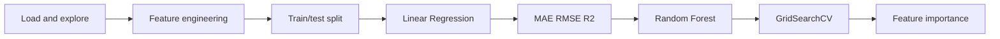

# California Housing Price Prediction

Scikit-learn regression pipeline that predicts median house values for California districts. Covers feature engineering, train/test split, Linear Regression vs Random Forest, GridSearchCV, and feature importance.

**Dataset:** [California Housing](https://scikit-learn.org/stable/modules/generated/sklearn.datasets.fetch_california_housing.html) (built into scikit-learn - no CSV needed).

**Target:** `MedHouseVal` (median house value, units of $100,000).

## Pipeline



| Step | What it does |
|------|----------------|
| 1 | Load California Housing; explore shape, stats, missing values |
| 2 | Engineer `RoomsPerPerson = AveRooms / AveOccup` |
| 3 | 80/20 train/test split (`random_state=42`) |
| 4 | Fit baseline `LinearRegression` |
| 5 | Evaluate with MAE, RMSE, R2 |
| 6 | Train `RandomForestRegressor` and compare |
| 7 | Tune RF with `GridSearchCV` on train only |
| 8 | Rank `feature_importances_` from the tuned model |

## Results (example run)

| Model | MAE | RMSE | R2 |
|-------|-----|------|-----|
| Linear Regression | 0.4959 | 0.6873 | 0.6395 |
| Random Forest | 0.3280 | 0.5047 | 0.8057 |
| Tuned Random Forest | **0.3273** | **0.5044** | **0.8059** |

**Best GridSearch params:** `n_estimators=100`, `max_depth=None`, `min_samples_leaf=2`

**Top feature:** `MedInc` (median income) - usually the strongest signal for house value here.

## How to run

**Requirements:** Python 3.10+

### Windows (PowerShell)

```powershell
git clone https://github.com/imrahimar/california-housing-price-prediction.git
cd california-housing-price-prediction

python -m venv venv
.\venv\Scripts\Activate.ps1
pip install -r requirements.txt
python house_prices.py
```

### macOS / Linux

```bash
git clone https://github.com/imrahimar/california-housing-price-prediction.git
cd california-housing-price-prediction

python3 -m venv venv
source venv/bin/activate
pip install -r requirements.txt
python house_prices.py
```

Step 7 (`GridSearchCV`) can take about 1 minute.

## Project structure

```
california-housing-price-prediction/
├── house_prices.py
├── requirements.txt
├── README.md
└── .gitignore
```

## Notes

- `venv/` is gitignored - do not commit it
- No API keys required; data loads from scikit-learn
- Clone with HTTPS or SSH (`git@github.com:imrahimar/california-housing-price-prediction.git`)

## License

Educational / portfolio project. California Housing data via scikit-learn.
